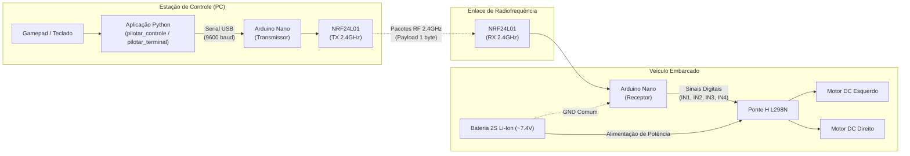

# Carrinho de Controle Remoto via Rádio 2.4GHz (Arduino & Python)

Sistema de controle e telemetria para veículo terrestre com tração diferencial, controlado remotamente por computador via rádio frequência (RF 2.4GHz). O projeto utiliza dois microcontroladores Arduino Nano, transceptores NRF24L01, ponte H L298N e scripts em Python para operação tanto por controle de videogame (gamepad) quanto por terminal de comandos.

---

## 1. Visão Geral e Arquitetura do Sistema

A arquitetura do projeto é dividida em dois subsistemas principais: a **Estação de Controle (Host/Transmissor)** e o **Veículo Embarcado (Receptor/Atuadores)**.



### Fluxo de Comunicação
1. O usuário gera entradas através de um gamepad ou teclado no computador.
2. A aplicação Python processa as entradas e transmite caracteres de comando (`W`, `S`, `A`, `D`, `X`) via porta serial USB a 9600 baud para o Arduino Transmissor.
3. O Arduino Transmissor empacota o caractere e o irradia via módulo NRF24L01 em 2.4GHz.
4. O módulo NRF24L01 do carrinho recebe o pacote e o entrega ao Arduino Receptor via barramento SPI.
5. O Arduino Receptor decodifica a instrução e aciona os transistores de potência da ponte H L298N, realizando o movimento diferencial correspondente.

---

## 2. Estrutura do Repositório

```text
carrinho-controle-remoto-arduino/
├── .gitignore
├── README.md
├── arduino/
│   ├── carrinho_receptor/
│   │   └── carrinho_receptor.ino    # Firmware do nó receptor embarcado
│   └── pc_transmissor/
│       └── pc_transmissor.ino       # Firmware do nó transmissor USB/Serial
└── controle_pc/
    ├── pilotar_controle.py          # Script de pilotagem via Joystick/Gamepad (Pygame)
    ├── pilotar_terminal.py          # Script de pilotagem direta via teclado no terminal
    └── requirements.txt             # Dependências de bibliotecas Python
```

---

## 3. Lista de Materiais e Componentes

| Item | Componente | Quantidade | Descrição / Observações |
| :--- | :--- | :---: | :--- |
| 1 | **Arduino Nano V3.0** | 2 un. | Microcontroladores ATmega328P (1x Transmissor, 1x Receptor). |
| 2 | **Módulo Transceptor NRF24L01+** | 2 un. | Comunicação RF 2.4GHz com alcance de até 100m em visada livre. |
| 3 | **Capacitores Eletrolíticos (10µF a 100µF)** | 2 un. | **Essenciais:** soldar/conectar diretamente entre VCC e GND de cada NRF24L01 para mitigar quedas de tensão e ruído de chaveamento. |
| 4 | **Driver de Motor Ponte H L298N** | 1 un. | Módulo de potência capaz de acionar e reverter rotação de motores DC de até 2A por canal. |
| 5 | **Motores DC com Caixa de Redução (Amarelos)** | 2 un. | Tensão nominal 3V a 6V (relação típica 48:1) para tração diferencial. |
| 6 | **Bateria Recarregável (~7.4V)** | 1 un. | Pack 2S Li-Ion (18650) ou LiPo para alimentação dos motores e circuitos. |
| 7 | **Chassi com Rodas e Roda Boba** | 1 un. | Estrutura mecânica básica para montagem veicular. |
| 8 | **Cabos Jumper (Macho-Fêmea, Macho-Macho)** | Diversos | Conexões de sinal e distribuição de alimentação. |

---

## 4. Esquemas e Tabelas de Ligação Elétrica (Pinagem)

### 4.1. Conexão do NRF24L01 (Comum a Ambos os Arduinos)

A interface de controle do NRF24L01 utiliza o barramento SPI padrão do microcontrolador ATmega328P, somado aos pinos de controle CE e CSN.

| Pino NRF24L01 | Pino Arduino Nano | Descrição da Função | Observações |
| :--- | :--- | :--- | :--- |
| **GND** | **GND** | Referência de Tensão (Terra) | Compartilhar referência com todo o sistema. |
| **VCC** | **3.3V** | Alimentação Lógica | ⚠️ **ATENÇÃO:** O NRF24L01 opera estritamente a 3.3V. **Não ligue no 5V**, sob risco de queima do rádio. |
| **CE** | **D7** | *Chip Enable* | Habilita RX ou TX no rádio. |
| **CSN** | **D8** | *SPI Chip Select* | Seleção do dispositivo no barramento SPI. |
| **SCK** | **D13** | *SPI Clock* | Linha de clock serial do barramento SPI. |
| **MOSI** | **D11** | *Master Out Slave In* | Linha de dados Arduino -> Rádio. |
| **MISO** | **D12** | *Master In Slave Out* | Linha de dados Rádio -> Arduino. |

> [!IMPORTANT]
> **Estabilidade de Alimentação RF:** Os módulos NRF24L01 são sensíveis a variações na linha de 3.3V fornecida pelo regulador do Arduino Nano. É altamente recomendável conectar um capacitor eletrolítico de **10 µF a 100 µF (16V)** soldado ou conectado na protoboard diretamente entre os pinos **VCC e GND** de cada módulo de rádio.

---

### 4.2. Conexão da Ponte H L298N no Carrinho (Receptor)

| Pino L298N | Conexão / Pino Arduino | Descrição da Operação |
| :--- | :--- | :--- |
| **IN1** | **D3** (Arduino) | Motor Esquerdo - Frente |
| **IN2** | **D5** (Arduino) | Motor Esquerdo - Ré |
| **IN3** | **D6** (Arduino) | Motor Direito - Frente |
| **IN4** | **D9** (Arduino) | Motor Direito - Ré |
| **ENA** | Jumper ativado | Habilita Canal A em velocidade plena (5V). |
| **ENB** | Jumper ativado | Habilita Canal B em velocidade plena (5V). |
| **Borne 12V** | Polo (+) da Bateria (~7.4V) | Entrada de alimentação de potência dos motores. |
| **Borne GND** | Polo (-) da Bateria **E** GND do Arduino | **GND COMUM OBRIGATÓRIO:** O terra da bateria, da ponte H e do Arduino Nano devem estar interconectados. |
| **Borne 5V** | VIN ou 5V do Arduino *(Opcional)* | Se o jumper de 5V interno da L298N estiver mantido, o borne 5V fornece saída regulada para alimentar o Arduino. |
| **OUT1 / OUT2** | Motor DC Esquerdo | Terminais do motor da roda esquerda. |
| **OUT3 / OUT4** | Motor DC Direito | Terminais do motor da roda direita. |

> [!CAUTION]
> **Obrigatoriedade de GND Comum:** Sem a conexão física entre o GND da bateria, o borne GND da ponte H e o pino GND do Arduino, o circuito fica sem referência de potencial, ocasionando falhas de chaveamento, ruídos erráticos ou bloqueio total dos motores.

---

## 5. Protocolo de Comunicação e Comandos

A comunicação trafega payloads de 1 byte (caractere ASCII) mapeados conforme a tabela abaixo:

| Comando | Ação no Veículo | Motor Esquerdo (IN1, IN2) | Motor Direito (IN3, IN4) |
| :---: | :--- | :---: | :---: |
| `'W'` | Avançar em linha reta | HIGH, LOW | HIGH, LOW |
| `'S'` | Recuar (marcha à ré) | LOW, HIGH | LOW, HIGH |
| `'A'` | Girar à esquerda | LOW, LOW | HIGH, LOW |
| `'D'` | Girar à direita | HIGH, LOW | LOW, LOW |
| `'X'` | Parada imediata de segurança | LOW, LOW | LOW, LOW |

---

## 6. Instalação e Execução Passo a Passo

### 6.1. Configuração do Ambiente Arduino IDE
1. Abra a **Arduino IDE**.
2. Acesse o **Gerenciador de Bibliotecas** (`Ctrl + Shift + I` ou menu *Sketch -> Incluir Biblioteca -> Gerenciar Bibliotecas...*).
3. Pesquise por **RF24** (desenvolvida por **TMRh20**) e instale a versão estável mais recente.
4. Conecte o **Arduino do Carrinho (Receptor)** via USB:
   - Abra o arquivo `arduino/carrinho_receptor/carrinho_receptor.ino`.
   - Selecione a placa `Arduino Nano`, o processador (`ATmega328P` ou `ATmega328P (Old Bootloader)`) e a porta serial correspondente.
   - Realize o upload.
5. Conecte o **Arduino do Computador (Transmissor)** via USB:
   - Abra o arquivo `arduino/pc_transmissor/pc_transmissor.ino`.
   - Selecione a porta serial correspondente e realize o upload.

---

### 6.2. Configuração do Ambiente Python
Certifique-se de possuir o Python (versão 3.8 ou superior) instalado em seu sistema operacional.

1. No terminal do seu computador, clone ou acesse a pasta raiz do repositório:
   ```bash
   cd caminho/para/carrinho-controle-remoto-arduino
   ```

2. (Recomendado) Crie e ative um ambiente virtual:
   ```bash
   # No Windows:
   python -m venv .venv
   .venv\Scripts\activate

   # No Linux/macOS:
   python3 -m venv .venv
   source .venv/bin/activate
   ```

3. Instale as bibliotecas necessárias listadas em `requirements.txt`:
   ```bash
   pip install -r controle_pc/requirements.txt
   ```

---

### 6.3. Operação e Pilotagem

Antes de iniciar os scripts em Python, certifique-se de que o **Monitor Serial da Arduino IDE esteja fechado**, liberando a porta serial COM.

#### Método A: Pilotagem via Controle de Videogame (Gamepad)
Conecte seu controle (PlayStation, Xbox, gamepad genérico USB ou Bluetooth) ao computador e execute:

```bash
# Execução padrão (porta COM3):
python controle_pc/pilotar_controle.py

# Ou informando explicitamente a porta serial do transmissor:
python controle_pc/pilotar_controle.py COM4
```
* **Controles:** Incline o analógico esquerdo para frente, ré, esquerda ou direita. Soltar o analógico retorna automaticamente o carrinho para a parada (`'X'`).
* **Saída:** Pressione `Ctrl + C` para finalizar.

---

#### Método B: Pilotagem Direta via Terminal
Permite manobrar o veículo a partir de qualquer console, sem a necessidade da Arduino IDE aberta:

```bash
# Execução padrão (porta COM3):
python controle_pc/pilotar_terminal.py

# Ou especificando a porta serial:
python controle_pc/pilotar_terminal.py COM4
```
* **Teclas:**
  * `W` - Avançar
  * `S` - Recuar
  * `A` - Girar à Esquerda
  * `D` - Girar à Direita
  * `X` - Parar Motores
  * `Q` - Encerrar a aplicação
* Em sistemas Windows, o comando é acionado de imediato ao pressionar a tecla.

---

#### Método Alternativo: Monitor Serial da Arduino IDE
Caso deseje testar a transmissão sem executar Python:
1. Abra o arquivo `pc_transmissor.ino` na Arduino IDE.
2. Abra o **Monitor Serial** (`Ctrl + Shift + M`).
3. Configure a taxa para **9600 baud**.
4. Digite as letras `W`, `S`, `A`, `D` ou `X` no campo de envio e pressione **Enter**.

---

## 7. Diagnóstico e Resolução de Problemas (Troubleshooting)

* **Erro "Access Denied" ou "Porta serial indisponível":** O Monitor Serial da Arduino IDE ou outro software pode estar retendo a porta COM. Feche todas as instâncias e tente novamente.
* **O módulo NRF24L01 exibe erro de inicialização:** Verifique as conexões SPI (pinos 7, 8, 11, 12, 13) e certifique-se de que o VCC está recebendo 3.3V com boa filtragem capacitiva.
* **Motores não giram ou giram de forma intermitente:** Verifique a tensão da bateria de potência (mínimo ~6.5V a 7.4V) e cheque a continuidade do GND comum entre a ponte H e o Arduino.
* **Motores girando em sentido invertido:** Inverta fisicamente a polaridade dos cabos do motor correspondente nos bornes OUT1/OUT2 ou OUT3/OUT4 da L298N.
